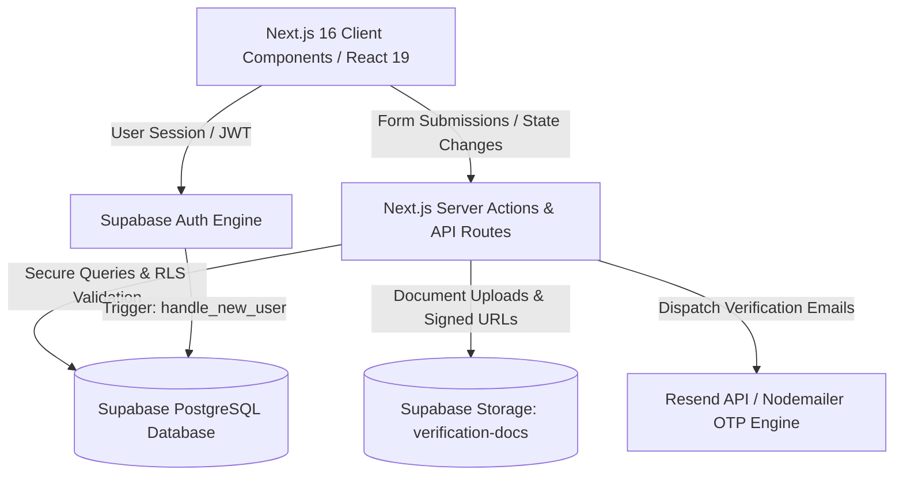
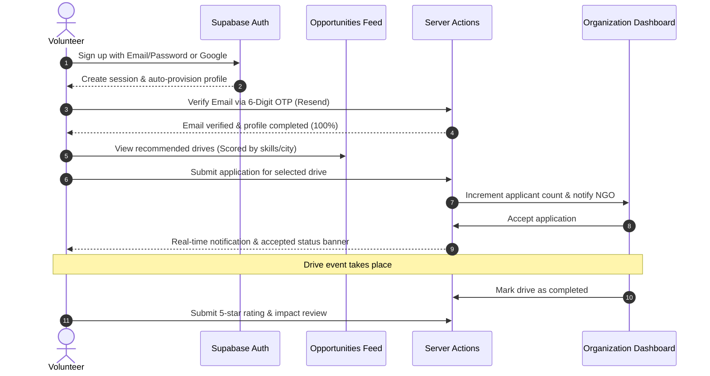
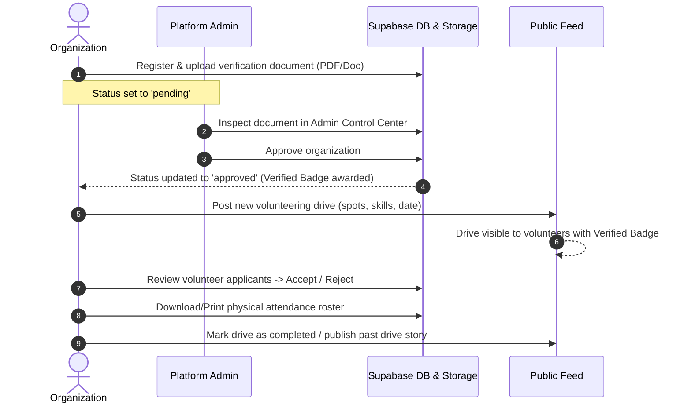
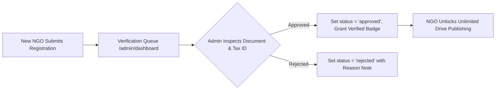

# 🤝 TogetherNow — Community Volunteering & Impact Orchestration Platform

[](https://nextjs.org/)
[](https://react.dev/)
[](https://www.typescriptlang.org/)
[](https://tailwindcss.com/)
[](https://supabase.com/)
[](LICENSE)

> **TogetherNow** is an end-to-end community impact platform that connects passionate volunteers with verified non-profits, civic institutions, and grassroots initiatives. Built with Next.js 16 (App Router), React 19, Supabase PostgreSQL, and Tailwind CSS v4, TogetherNow streamlines the entire volunteering lifecycle — from intelligent skill-based matching and OTP-verified onboarding to drive publishing, real-time applicant roster tracking, secure document verification, and post-event impact reviews.

---

## 📑 Table of Contents

- [Overview & Vision](#-overview--vision)
- [Key Features](#-key-features)
  - [1. For Volunteers](#1-for-volunteers)
  - [2. For Organizations (NGOs)](#2-for-organizations-ngos)
  - [3. For Platform Administrators](#3-for-platform-administrators)
  - [4. For Donors](#4-for-donors)
- [System Architecture & Tech Stack](#-system-architecture--tech-stack)
- [End-to-End User Workflows](#-end-to-end-user-workflows)
  - [Volunteer Lifecycle Flow](#volunteer-lifecycle-flow)
  - [Organization Lifecycle Flow](#organization-lifecycle-flow)
  - [Admin Verification Flow](#admin-verification-flow)
- [Intelligent Recommendation Engine](#-intelligent-recommendation-engine)
- [Database Schema & Architecture](#-database-schema--architecture)
- [Project Directory Structure](#-project-directory-structure)
- [Environment Configuration](#-environment-configuration)
- [Getting Started & Local Development](#-getting-started--local-development)
  - [Prerequisites](#prerequisites)
  - [Installation Steps](#installation-steps)
  - [Database Setup with Supabase](#database-setup-with-supabase)
- [API Routes & Server Actions Reference](#-api-routes--server-actions-reference)
- [Security & Row Level Security (RLS)](#-security--row-level-security-rls)
- [Contributing](#-contributing)
- [License](#-license)

---

## 🌟 Overview & Vision

Civic engagement and volunteering often suffer from fragmented communication, opaque organization credentials, manual attendance tracking, and lack of personalized opportunity discovery.

**TogetherNow** solves these challenges by providing:
1. **Trust & Verification**: Organizations must undergo formal credential and document verification (80G/12A/NGO registration certificates) before earning verified badges.
2. **Intelligent Match Scoring**: Volunteers receive tailored drive suggestions scored against their recorded skills, thematic interests, and geographic location.
3. **Operational Drive Management**: Real-time spot limits, applicant vetting (accept/reject), printable attendance sheets, and emergency drive cancellation alerts.
4. **Transparent Feedback Loop**: Volunteers can review organizations and rate completed events across three key dimensions: Organization Management, Volunteer Support, and Real Impact.

---

## ✨ Key Features

### 1. For Volunteers

- **Personalized Recommendations**: Scored algorithm matches opportunities to volunteer skills, interests, and city with granular percentage indicators and reason badges.
- **Interactive Feed & Multi-Filters**: Filter drives by category (*Environment, Education, Health, Community, Tech, Crisis Support*), mode (*In-Person vs. Remote*), and search query.
- **Seamless 1-Click Application**: Apply with custom notes/motivation statements; automatic duplicate detection and real-time spot decrement.
- **Application Status Hub**: Track submission status (*Pending, Accepted, Rejected*), view drive manager direct phone/email, and access Google Maps directions.
- **Email OTP Profile Verification**: 6-digit secure OTP verification sent via Resend/Nodemailer to validate identity and reach 100% profile completion.
- **Organization Portfolio Modals**: Inspect an NGO's mission, vision, year founded, registration number, photo gallery, past drives, and volunteer ratings.
- **Review & Ratings**: Leave 5-star ratings, sub-dimension evaluations, and feedback on completed volunteering drives.
- **Notification Inbox**: Instant notifications for application updates, event cancellation notices, and newly published drives.

### 2. For Organizations (NGOs)

- **Official Onboarding & Verification**: Upload official non-profit registration certificates, enter tax/NGO IDs, and link official websites for administrative review.
- **Drive Lifecycle Management**:
  - Create drives with spot limits, required skills, manager contacts, date/time, and remote/in-person mode.
  - Edit manager contact details and addresses post-launch.
  - Close or reopen application windows at will.
  - Cancel events with mandatory volunteer-facing reason notices (pushes real-time alerts to all applicants).
  - Mark drives as completed to move them to impact history.
- **Applicant Vetting & Attendance Roster**:
  - Review volunteer applicants with full profiles, skill sets, and motivation notes.
  - Accept or reject applicants with live capacity sync.
  - Direct 1-click volunteer contact via phone and email.
  - Export attendance rosters as CSV, copy to clipboard, or generate print-ready physical sheets.
- **Customizable Organization Showcase**:
  - Interactive profile editor for tagline, mission, vision, causes, contact numbers, and social links.
  - Curated photo gallery and past events archive with impact figures (hours volunteered, people impacted).
  - Live review score breakdown (Management, Support, Impact) and star distribution metrics.

### 3. For Platform Administrators

- **Admin Control Center (`/admin/dashboard`)**:
  - Dedicated administrative dashboard to review pending non-profit and donor verifications.
  - Embedded secure document viewer with signed URLs supporting PDFs, PNGs, and JPEGs.
  - Instant 1-click Approval or Rejection with audit notes.
  - Live filterable queues for organizations and high-impact corporate donors.

### 4. For Donors

- Verified NGO discovery for philanthropic contributions.
- Clear transparency on organization registration, history, and community track record.

---

## 🏗 System Architecture & Tech Stack



| Layer | Technology | Purpose |
| :--- | :--- | :--- |
| **Framework** | **Next.js 16.2.10 (App Router)** | Server Components, Server Actions, Dynamic Routing, API Routes |
| **UI Library** | **React 19.2.4** | Modern reactive hooks, transitions, optimistic states |
| **Styling** | **Tailwind CSS v4 + tw-animate-css** | Custom design system, responsive glassmorphism, responsive grid |
| **Database & Auth**| **Supabase (PostgreSQL 15+)** | Relational schema, Auth triggers, Row Level Security (RLS) |
| **File Storage** | **Supabase Storage** | Encrypted bucket (`verification-docs`) for NGO legal proof |
| **Email Delivery** | **Resend API & Nodemailer** | 6-digit cryptographic OTP delivery with custom HTML template |
| **Icons** | **Lucide React** | Clean, accessible iconography across all dashboards |
| **Type Safety** | **TypeScript 5** | Strict interface typing across database, client, and server |

---

## 🔄 End-to-End User Workflows

### Volunteer Lifecycle Flow



### Organization Lifecycle Flow



### Admin Verification Flow



---

## 🧠 Intelligent Recommendation Engine

The recommendation engine (`src/lib/recommendations.ts`) scores each active volunteering opportunity against a volunteer's profile attributes:

1. **Skill Matching (+35 points per match)**:
   - Direct matching between opportunity required skills and volunteer profile skills.
   - Built-in synonym dictionary and keyword stemming (e.g., `coding` ↔ `programming`, `software`, `python`; `environment` ↔ `nature`, `marine`, `cleanup`).
2. **Interest Alignment (+25 points per match)**:
   - Evaluates category and description against volunteer interest tags.
3. **Geographic Proximity (+25 points)**:
   - Location match based on the volunteer's selected city/region.
4. **Remote Opportunity Flexibility (+15 points)**:
   - Remote drives receive a bonus accessibility boost for high volunteer reach.
5. **Output Metrics**:
   - Computes a normalized **Match Percentage (0–100%)**.
   - Generates human-readable **Match Reasons** (e.g., *"Matches your coding skill"*, *"Matches your interest in Environment"*, *"In your city: Mumbai"*).

---

## 🗄 Database Schema & Architecture

The database schema is defined in `supabase/migrations/20260720000001_initial_schema.sql` and subsequent migrations:

### Core Tables

| Table Name | Description | Key Relationships |
| :--- | :--- | :--- |
| `profiles` | Primary user identity table extending `auth.users`. Stores name, role, phone, location, bio. | `id` references `auth.users(id)` |
| `volunteer_profiles` | Profile extension for volunteers. Contains skills array, interests array, and total hours. | `id` references `profiles(id)` |
| `organizations` | Profile extension for NGOs. Contains registration number, document URL, website, verification status. | `id` references `profiles(id)` |
| `opportunities` | Master directory of volunteering drives with title, category, spots, date, time, location, skills needed. | `organization_id` references `auth.users(id)` |
| `events` | Concrete scheduled instances of opportunities with latitude, longitude, and timestamps. | `opportunity_id` references `opportunities(id)` |
| `applications` | Volunteer drive applications tracking statuses (`pending`, `accepted`, `rejected`). | Unique constraint `(volunteer_id, opportunity_id)` |
| `attendance` | Check-in/check-out operational clocking system with virtual calculated hours. | Unique constraint `(volunteer_id, event_id)` |
| `donations` | Financial transaction logs for direct organization support. | References `donor_id` and `organization_id` |
| `badges` & `user_badges`| Gamification engine awarding milestone badges based on hours volunteered. | Many-to-many relationship |
| `certificates` | Issued completion certificates linking volunteers to successfully completed drives. | Unique constraint `(volunteer_id, opportunity_id)` |
| `notifications` | In-app user notifications for application status updates, drive alerts, and announcements. | References `user_id` |
| `audit_logs` | Immutable audit trail for security and regulatory compliance. | References `changed_by` |

---

## 📁 Project Directory Structure

```text
TogetherNow/
├── public/                     # Static assets, icons, and illustrations
├── src/
│   ├── app/
│   │   ├── actions/            # Next.js Server Actions (Backend Logic)
│   │   │   ├── admin.ts        # Admin approval/rejection actions
│   │   │   ├── auth.ts         # Sign-in, sign-up, sign-out, OAuth, account deletion
│   │   │   ├── onboarding.ts   # Profile completion server actions
│   │   │   ├── opportunities.ts# Opportunity creation, applicant status, drive management
│   │   │   └── verification.ts # OTP email dispatch, OTP validation, profile persistence
│   │   ├── admin/
│   │   │   ├── dashboard/      # Admin Control Center UI & verification queues
│   │   │   └── login/          # Protected Admin authentication route
│   │   ├── api/
│   │   │   ├── document/       # Secure document viewer with signed URLs & fallback
│   │   │   └── upload-verification/ # Multipart document upload to Supabase Storage
│   │   ├── auth/
│   │   │   ├── callback/       # OAuth redirect exchange handler
│   │   │   ├── error/          # Authentication error view
│   │   │   ├── login/          # Login page with password & OAuth options
│   │   │   └── signup/         # Signup page with role selection (Volunteer / Org)
│   │   ├── dashboard/          # Dynamic role-based dashboard router
│   │   ├── onboarding/         # Guided post-signup onboarding forms
│   │   ├── globals.css         # Global design tokens and Tailwind utility styles
│   │   ├── landing.css         # Custom animations and landing page aesthetics
│   │   ├── layout.tsx          # Root HTML layout and font configurations
│   │   └── page.tsx            # Public marketing landing page
│   ├── components/
│   │   └── ui/
│   │       ├── DashboardNavbar.tsx              # Main authenticated navigation bar
│   │       ├── DeleteAccountModal.tsx           # Account deletion with safety confirmation
│   │       ├── FeaturesSection.tsx              # Landing page feature showcase
│   │       ├── HeroSection.tsx                  # Landing page hero with animated badges
│   │       ├── Logo.tsx                         # SVG brand logo component
│   │       ├── Navbar.tsx                       # Public landing page navigation
│   │       ├── OpportunitiesFeed.tsx            # Drive feed, search, filters & details
│   │       ├── OrganizationAboutEditorModal.tsx # NGO profile editor modal
│   │       ├── OrganizationAboutModal.tsx       # Public NGO portfolio & impact view
│   │       ├── OrganizationDashboard.tsx        # NGO control panel, drives & applicants
│   │       ├── OrganizationRatingModal.tsx      # Post-event volunteer review modal
│   │       ├── ProfileCompletionModal.tsx       # Modal for updating skills & OTP
│   │       ├── ProfilePromptBanner.tsx          # Profile completion reminder banner
│   │       ├── RecommendedOpportunitiesSection.tsx # AI/algorithmic match carousel
│   │       ├── ResubmitApplicationButton.tsx    # Resubmission CTA for rejected NGOs
│   │       └── VolunteerDashboard.tsx           # Volunteer applications & stats hub
│   └── lib/
│       ├── notifications.ts    # Notification storage, dispatcher & subscriber
│       ├── organizations.ts    # Mock profiles, schemas & persistent storage keys
│       ├── ratings.ts          # Rating aggregates, star distribution & review models
│       ├── recommendations.ts  # Intelligent matching algorithm & synonym dictionaries
│       ├── utils.ts            # Tailwind CSS class merger (clsx + twMerge)
│       └── supabase/
│           ├── client.ts       # Browser Supabase client (client components)
│           ├── server.ts       # Server-side Supabase client (cookies & server actions)
│           └── types.ts        # TypeScript definitions for database entities
├── supabase/
│   ├── config.toml             # Local Supabase CLI configuration
│   └── migrations/             # Versioned SQL migrations for schema & policies
├── .env.example                # Example environment variables template
├── components.json             # Shadcn component configuration
├── next.config.ts              # Next.js configuration
├── package.json                # Project dependencies and npm scripts
└── tsconfig.json               # TypeScript compiler configuration
```

---

## ⚙ Environment Configuration

Create a `.env.local` file in the root directory and configure the following variables:

```bash
# =====================================================
# Supabase Configuration
# Obtain from: https://supabase.com/dashboard/project/<ref>/settings/api
# =====================================================

# Public URL of your Supabase instance
NEXT_PUBLIC_SUPABASE_URL=https://your-project-ref.supabase.co

# Public anonymous key (Safe for browser client)
NEXT_PUBLIC_SUPABASE_ANON_KEY=your-anon-key-here

# Private Service Role Key (NEVER expose to client; used in Server Actions / Admin)
SUPABASE_SERVICE_ROLE_KEY=your-service-role-key-here

# =====================================================
# Maps Integration
# =====================================================
NEXT_PUBLIC_GOOGLE_MAPS_API_KEY=your-google-maps-api-key-here

# =====================================================
# Email Delivery (Resend / Nodemailer)
# Sign up at: https://resend.com
# =====================================================
RESEND_API_KEY=re_your_resend_api_key
RESEND_FROM_EMAIL=TogetherNow <onboarding@resend.dev>

# Optional SMTP fallback for custom mailers:
# SMTP_HOST=smtp.gmail.com
# SMTP_PORT=587
# SMTP_USER=your-email@gmail.com
# SMTP_PASS=your-app-password
```

---

## 🚀 Getting Started & Local Development

### Prerequisites

- **Node.js**: `v20.x` or higher recommended
- **npm** or **pnpm** or **bun**
- A **Supabase** project (free tier at [supabase.com](https://supabase.com))

### Installation Steps

1. **Clone the repository**:
   ```bash
   git clone https://github.com/your-username/TogetherNow.git
   cd TogetherNow
   ```

2. **Install dependencies**:
   ```bash
   npm install
   ```

3. **Configure Environment Variables**:
   ```bash
   cp .env.example .env.local
   # Fill in your Supabase, Resend, and API keys
   ```

4. **Run the local development server**:
   ```bash
   npm run dev
   ```

5. **Open the application**:
   Navigate to [http://localhost:3000](http://localhost:3000) in your web browser.

### Database Setup with Supabase

To apply the complete database schema to your Supabase instance:

1. **Option A: Using Supabase Web Dashboard**:
   - Go to your project's **SQL Editor** in the Supabase Dashboard.
   - Run the contents of `supabase/migrations/20260720000001_initial_schema.sql`.
   - Run the subsequent migrations in order:
     - `20260822000001_add_registration_number_to_organizations.sql`
     - `20260822000002_setup_verification_docs_bucket.sql`
     - `20260822000003_create_posted_opportunities_table.sql`

2. **Option B: Using Supabase CLI**:
   ```bash
   # Link to your remote project
   npx supabase link --project-ref <your-project-ref>

   # Push migrations
   npx supabase db push
   ```

---

## 🔌 API Routes & Server Actions Reference

### Server Actions (`src/app/actions/`)

- **`auth.ts`**:
  - `signupAction(formData)`: Registers user, binds role metadata, dispatches auto-profile trigger.
  - `loginAction(formData)`: Authenticates user credentials and redirects to dashboard.
  - `signInWithGoogleAction()`: Initiates Supabase OAuth authentication flow.
  - `logoutAction()`: Terminates active session and clears auth cookies.
  - `deleteAccountAction()`: Performs cascading deletion of user account and related profile data.
- **`opportunities.ts`**:
  - `createOpportunityAction(input)`: Persists new volunteering drive with spots and contact details.
  - `fetchOpportunitiesAction()`: Retrieves active drives with organization metadata.
  - `submitVolunteerApplicationAction(payload)`: Records application and decrements spots.
  - `updateApplicantStatusAction(payload)`: Modifies application state (`accepted` / `rejected`).
  - `cancelOpportunityAction(payload)`: Cancels drive and dispatches volunteer cancellation alert.
  - `toggleApplicationsAction(payload)`: Closes or reopens application intake.
  - `markOpportunityCompletedAction(payload)`: Moves drive to completed state and unlocks ratings.
- **`verification.ts`**:
  - `sendEmailOtpAction(email)`: Dispatches 6-digit OTP code to volunteer's email address.
  - `verifyEmailOtpAction(email, otp)`: Validates code and marks email as verified.
  - `saveCompleteUserProfileAction(input)`: Persists volunteer skills, interests, city, and phone.
- **`admin.ts`**:
  - `approveOrganizationAction(orgId)`: Approves NGO and grants verified badge.
  - `rejectOrganizationAction(orgId, reason)`: Rejects submission with explanatory feedback.
  - `fetchAdminOrganizations()`: Retrieves organization queue for administrative vetting.

### REST API Routes (`src/app/api/`)

- **`POST /api/upload-verification`**:
  - Accepts multipart form data (`file`, `orgId`).
  - Uploads document to private Supabase Storage bucket `verification-docs`.
  - Returns public or signed document URI.
- **`GET /api/document`**:
  - Secure document proxy endpoint.
  - Authenticates administrative access and generates time-limited signed download URLs for verification PDFs/images.

---

## 🔒 Security & Row Level Security (RLS)

TogetherNow is built with enterprise security standards:

- **Row Level Security (RLS)** is enabled on all PostgreSQL tables.
- **Profiles Table**: Users can view all profiles, but can only mutate their own records (`auth.uid() = id`).
- **Organizations Table**: Public can view approved organizations; unapproved/pending organizations are visible only to themselves and admins.
- **Applications Table**: Volunteers can only read and create their own applications; organizations can only read applications for opportunities they created.
- **Verification Storage**: Documents uploaded to the `verification-docs` bucket are protected from unauthorized public crawling.
- **Database Trigger**: New signups automatically initialize a `profiles` row using a `SECURITY DEFINER` PostgreSQL function (`handle_new_user`), preventing unauthorized role spoofing.

---

## 🤝 Contributing

Contributions to TogetherNow are warmly welcomed! To contribute:

1. **Fork the repository**.
2. **Create a feature branch**:
   ```bash
   git checkout -b feature/amazing-feature
   ```
3. **Commit your changes**:
   ```bash
   git commit -m "feat: Add amazing new feature"
   ```
4. **Push to the branch**:
   ```bash
   git push origin feature/amazing-feature
   ```
5. **Open a Pull Request** with a detailed summary of your changes.

---

## 📄 License

This project is licensed under the **MIT License** — feel free to use and adapt it for community initiatives and educational purposes.

---

<p align="center">
  Made with ❤️ for a better tomorrow by the <strong>TogetherNow</strong> team.
</p>
